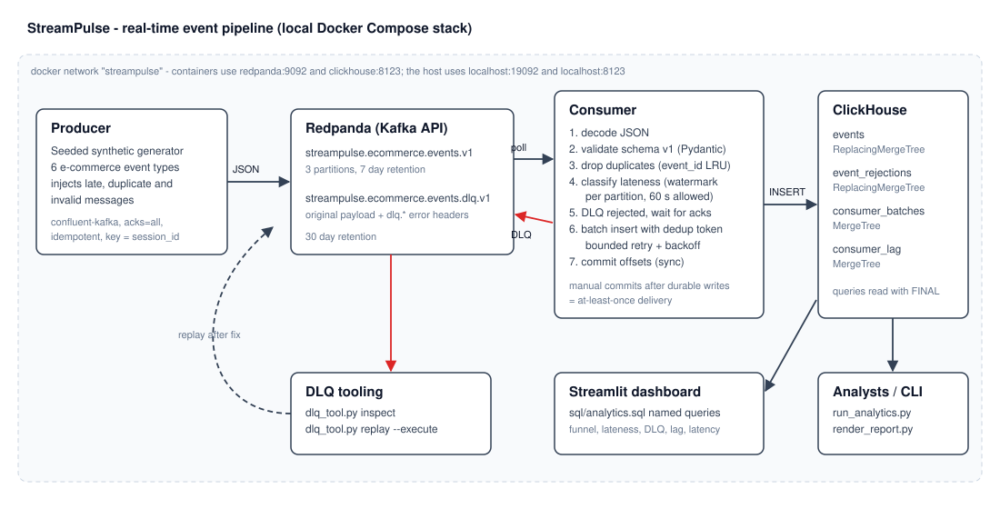
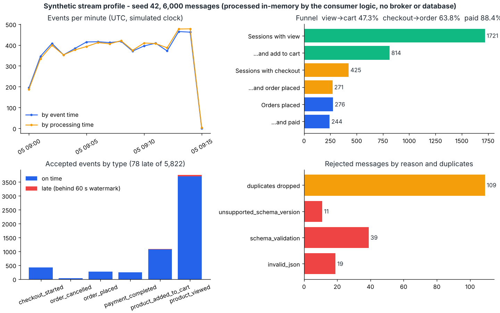

# StreamPulse — Real-Time Event Platform

[](https://github.com/bsdgsmm/streampulse-realtime-analytics/actions/workflows/ci.yml)

A production-inspired streaming data pipeline for a fictional e-commerce company.
A Python producer publishes synthetic shopping events to **Redpanda** (Kafka API),
a Python consumer validates, deduplicates and classifies them by event time, and
**ClickHouse** stores them for real-time analytics. A Streamlit dashboard and a set
of named SQL queries expose funnel, data-quality and pipeline-health metrics.

> All data in this project is **synthetic**, produced by a seeded generator. Every
> event carries `is_synthetic: true` and `source: "streampulse-synthetic-generator"`.
> This is a portfolio project that demonstrates streaming data engineering
> practices; it is not a production-ready e-commerce or payments platform.

## Contents

1. [Business problem](#1-business-problem)
2. [Architecture](#2-architecture)
3. [Event lifecycle](#3-event-lifecycle)
4. [Technology choices](#4-technology-choices)
5. [Event schema](#5-event-schema)
6. [Delivery guarantees and deduplication](#6-delivery-guarantees-and-deduplication)
7. [Late and out-of-order events](#7-late-and-out-of-order-events)
8. [ClickHouse schema and queries](#8-clickhouse-schema-and-queries)
9. [Monitoring](#9-monitoring)
10. [Local setup](#10-local-setup)
11. [Running the demo](#11-running-the-demo)
12. [Tests and linting](#12-tests-and-linting)
13. [Visualizations](#13-visualizations)
14. [Troubleshooting](#14-troubleshooting)
15. [Known limitations](#15-known-limitations)
16. [Future improvements](#16-future-improvements)
17. [Skills demonstrated](#17-skills-demonstrated)

## 1. Business problem

An online shop wants to see what customers are doing *now*: how many products are
viewed per minute, how many sessions add something to the cart, how many checkouts
turn into orders and payments — and whether the pipeline delivering those numbers
can be trusted. Event streams are messy: mobile clients send events late, producers
retry and create duplicates, and some messages are malformed. StreamPulse shows how
to deliver useful real-time metrics while handling those problems explicitly and
measuring them instead of hiding them.

Events handled: `product_viewed`, `product_added_to_cart`, `checkout_started`,
`order_placed`, `payment_completed`, `order_cancelled`.

## 2. Architecture



| Component | Role | Code |
|---|---|---|
| Generator | Deterministic session/funnel simulation with injected faults | `src/streampulse/events/generator.py` |
| Producer | Publishes JSON to `streampulse.ecommerce.events.v1`, keyed by `session_id` | `src/streampulse/producer/main.py` |
| Redpanda | Kafka-compatible broker: events topic (3 partitions) and DLQ topic | `docker-compose.yml` |
| Consumer | Validation, deduplication, lateness, DLQ, batched writes, offset commits | `src/streampulse/consumer/` |
| ClickHouse | Analytical storage plus operational metric tables | `sql/schema.sql` |
| Analytics | Named SQL queries shared by dashboard, CLI and tests | `sql/analytics.sql` |
| Dashboard | Streamlit monitor on top of the same queries | `dashboard/app.py` |

## 3. Event lifecycle

1. **Generated.** The generator simulates sessions on a virtual clock. Each event gets
   an `event_timestamp` (when the user acted) and a delivery delay; about 3% of events
   are delayed 2–15 minutes to simulate offline clients. About 2% are re-sent as exact
   duplicates and about 1% are emitted as invalid messages.
2. **Produced.** The producer re-stamps `produced_at` with the wall-clock send time and
   keeps the generated delay, then publishes with `acks=all` and
   `enable.idempotence=true`. The key is `session_id`, so a session's events share a
   partition and keep their order.
3. **Consumed.** The consumer polls a batch (default 500 messages / 1 s).
4. **Validated.** Each message is decoded and validated against schema v1. Failures
   become *rejections* with a reason (`invalid_json`, `schema_validation`,
   `unsupported_schema_version`, …).
5. **Deduplicated.** Events whose `event_id` was already seen in the batch or in the
   recent-ID cache are counted as duplicates and not written again.
6. **Classified by event time.** A per-partition watermark marks events as late.
7. **Dead-lettered.** Rejected messages are published unchanged to
   `streampulse.ecommerce.events.dlq.v1` with error headers; the consumer waits for
   broker acknowledgement.
8. **Stored.** Rejections and valid events are inserted into ClickHouse with
   deterministic deduplication tokens and bounded retries.
9. **Committed.** Offsets (`last offset + 1` per partition) are committed synchronously.
10. **Observed.** Batch metrics and a consumer-lag sample are written to ClickHouse.

## 4. Technology choices

| Choice | Why |
|---|---|
| **Redpanda** instead of Apache Kafka | Single container, no ZooKeeper/KRaft setup, starts in seconds, speaks the Kafka protocol so the code uses the standard `confluent-kafka` client unchanged. Swapping in Kafka only changes `docker-compose.yml`. |
| **confluent-kafka** (librdkafka) | Mature client with idempotent producer, manual offset control and watermark queries. |
| **ClickHouse** | Columnar engine built for append-heavy event data and time-bucketed aggregations; `ReplacingMergeTree` gives storage-level deduplication. |
| **Pydantic v2** | Declarative schema with cross-field rules and precise error messages that go straight into the DLQ metadata. |
| **Streamlit** | Small, readable dashboard that reuses the SQL catalogue instead of duplicating logic. |
| **Docker Compose** | Reproducible local stack with health checks; nothing external or paid. |

Not used on purpose: Spark/Flink (one Python consumer group handles this volume and keeps the
delivery logic visible), Kubernetes, and a schema registry (a single versioned JSON contract is
enforced in code; a registry is listed under future improvements).

### Compatibility constraints

| Component | Version | Notes |
|---|---|---|
| Python | 3.12+ | CI runs 3.12 and 3.13; the code uses PEP 695 generics. |
| confluent-kafka | >=2.6,<3 | Provides wheels for Linux and macOS (x86-64, arm64). |
| clickhouse-connect | >=0.8,<1 | HTTP interface (port 8123). |
| pydantic | >=2.8,<3 | v2 API only. |
| Redpanda | v24.2.7 | `--mode=dev-container` single-node settings. |
| ClickHouse | 24.8 LTS | `insert_deduplication_token` with `non_replicated_deduplication_window`. |

Images can be overridden with `REDPANDA_VERSION` / `CLICKHOUSE_VERSION`.

## 5. Event schema

Schema version **1**, defined in `src/streampulse/events/schemas.py`.

| Field | Type | Rule |
|---|---|---|
| `event_id` | UUID | Required. Stable identity used for deduplication. |
| `event_type` | enum | One of the six event types. |
| `event_timestamp` | ISO-8601 with offset | Required, normalised to UTC. When the action happened (event time). |
| `produced_at` | ISO-8601 with offset | Required, normalised to UTC. When the producer sent it. `event_timestamp` may not be later than `produced_at` + 5 s skew. |
| `user_id` | string `u_NNNNNN` | Required. |
| `session_id` | string `s_` + 16 hex | Required. Also the message key. |
| `product_id` | string `p_NNNN` | Required for `product_viewed` and `product_added_to_cart`; forbidden otherwise. |
| `order_id` | string `o_` + 16 hex | Required for `order_placed`, `payment_completed`, `order_cancelled`; forbidden otherwise. |
| `amount` | decimal(12,2) > 0 | Required for `order_placed` and `payment_completed`; optional for `checkout_started` and `order_cancelled`; forbidden for product events. |
| `currency` | `EUR` `USD` `GBP` `TRY` | Must be present exactly when `amount` is present. |
| `schema_version` | `1` | Other versions are rejected as `unsupported_schema_version`. |
| `source` | string | Lineage marker. |
| `is_synthetic` | strict boolean | `true` for all generated data. |

Unknown fields are **ignored, not rejected** (tolerant reader), so a producer can add a
field without breaking the consumer. Their names are stored in `events.unexpected_fields`
and counted, so schema drift is visible.

Sample message (the first `order_placed` event produced by `make generate-events`, seed 42):

```json
{
  "amount": "97.60",
  "currency": "GBP",
  "event_id": "6b7a2460-604e-46cb-b712-f2d187cdb6a1",
  "event_timestamp": "2026-01-05T09:01:25.021000Z",
  "event_type": "order_placed",
  "is_synthetic": true,
  "order_id": "o_39681c817b70c3b8",
  "produced_at": "2026-01-05T09:01:25.250000Z",
  "schema_version": 1,
  "session_id": "s_aa53c19cdfa4bb9f",
  "source": "streampulse-synthetic-generator",
  "user_id": "u_002896"
}
```

### Why event time and processing time differ

`event_timestamp` is when the customer acted; `produced_at` is when the message left the
producer; `ingested_at` (added by the consumer) is when it was stored. A phone in a tunnel
can buffer a "view" for minutes. Business metrics ("views between 10:00 and 10:01") must
use event time; operational metrics ("is the consumer keeping up?") use production and
ingestion time. StreamPulse stores all three and the analytics distinguish them.

## 6. Delivery guarantees and deduplication

**StreamPulse provides at-least-once delivery with deduplicated analytical results.** It
does not claim end-to-end exactly-once processing.

| Concern | Strategy |
|---|---|
| Producer retries | `enable.idempotence=true`, `acks=all`: the broker discards duplicates caused by the producer's *internal* retries within one producer session. Application-level resends (simulated by the generator) still reach the topic. |
| Offset management | `enable.auto.commit=false`. Offsets are committed synchronously **after** the DLQ publish was acknowledged and the ClickHouse inserts succeeded. |
| Consumer restart | Restart resumes from the last committed offset. Anything processed but not committed is redelivered. |
| Duplicate detection | (1) in-batch `event_id` set, (2) bounded LRU cache of recently written IDs (default 100,000), updated only after a successful write, (3) storage-level dedup. |
| Database write retries | Transient errors (connection, timeout, selected ClickHouse error codes) are retried with exponential backoff and full jitter (default 5 attempts, 0.5 s base, 8 s cap). Permanent errors are not retried. |
| Ambiguous inserts | Each insert carries `insert_deduplication_token = sha256(sorted event_ids)`. If an insert succeeded but the response was lost, the retried insert is ignored by ClickHouse. |
| Retries exhausted | The consumer stops with exit code 2 **without committing**; after restart the batch is replayed and deduplicated. |
| Partial batch failure | Valid and invalid messages in one batch are handled separately; the batch is committed once, only when both paths succeeded. One ClickHouse insert per batch is atomic for that block. |
| Poison messages | Validation failures are deterministic, so they are **not retried**: they go to the DLQ immediately and are also stored in `event_rejections`. Nothing is silently dropped. |
| DLQ failure | If the DLQ publish is not acknowledged, the consumer exits (code 3) without committing. |
| Graceful shutdown | SIGINT/SIGTERM finish the current batch, commit, then close the consumer (leaving the group cleanly). The producer flushes its queue and reports undelivered messages. |

**Broker-level guarantees vs. storage-level deduplication.** Broker settings control how
messages are *written to and read from the log*: idempotence prevents duplicate appends
from one producer's retries, and committed offsets decide what is redelivered. They cannot
know that two different messages represent the same business event, and they cannot make
a ClickHouse write and an offset commit atomic. Correct analytics therefore come from the
storage layer: `events` is a `ReplacingMergeTree` keyed by
`(event_type, event_timestamp, event_id)`, and every analytical query reads `FINAL`
(or counts `uniqExact(event_id)`). Inserting an event twice creates two physical rows
until a background merge; queries see one logical event. `storage_duplicate_check`
shows both numbers.

### Inspecting and replaying the DLQ

```bash
make dlq-inspect
.venv/bin/python scripts/dlq_tool.py replay --error-type unsupported_schema_version
.venv/bin/python scripts/dlq_tool.py replay --error-type unsupported_schema_version --execute
```

DLQ messages keep the original key and value byte-for-byte. Headers:
`dlq.error_type`, `dlq.error_message`, `dlq.source_topic`, `dlq.source_partition`,
`dlq.source_offset`, `dlq.failed_at`, `dlq.consumer_group`, and `dlq.event_id` when present.
Replayed messages that still fail are rejected again.

## 7. Late and out-of-order events

* **Definition.** For each partition the consumer tracks the maximum `event_timestamp`
  seen. Watermark = that maximum − allowed lateness (default **60 s**, configurable with
  `STREAMPULSE_ALLOWED_LATENESS_SECONDS`). An event whose `event_timestamp` is older than
  the current watermark of its partition is **late**.
* **Handling.** Late events are **accepted and stored** with `is_late = true` and
  `lateness_ms` (how far behind the watermark). Nothing is dropped, so event-time
  aggregates converge to the right numbers once late data arrives; queries can include or
  exclude late events.
* **Out of order but within the allowed lateness** events are not flagged.
* **Windows.** Aggregations are tumbling buckets (`toStartOfMinute`,
  `toStartOfFiveMinutes`, `toDate`) over UTC. Boundaries are inclusive at the start and
  exclusive at the end. Because late events are inserted into past buckets, **event-time
  buckets keep changing**; ingestion-time buckets are final once the minute has passed.
  `event_time_vs_ingestion_time` puts both side by side.
* **Not a stream processor.** Watermarks are used for *classification*, not to close
  windows or emit final results. There is no state store; watermarks reset on restart and
  on partition reassignment (the first events afterwards count as on time).

## 8. ClickHouse schema and queries

| Table | Engine | Sorting key | Partition | Purpose |
|---|---|---|---|---|
| `events` | ReplacingMergeTree | `(event_type, event_timestamp, event_id)` | `toYYYYMM(event_timestamp)` | One row per accepted event plus lateness, latency and Kafka lineage columns. |
| `event_rejections` | ReplacingMergeTree | `(kafka_topic, kafka_partition, kafka_offset)` | – | Invalid messages (payload truncated to 4 KB), 30-day TTL. |
| `consumer_batches` | MergeTree | `(batch_started_at, batch_id)` | `toYYYYMM(batch_started_at)` | Per-batch counts, retries, processing time and latency, 30-day TTL. |
| `consumer_lag` | MergeTree | `(consumer_group, topic, partition, observed_at)` | – | Lag samples after each commit, 7-day TTL. |

**Engine trade-offs.** `ReplacingMergeTree` deduplicates only rows that share the full
sorting key and only during merges, at an unpredictable time — so `FINAL` is required at
query time, which costs extra CPU on large tables. The sorting key starts with
`event_type` because most queries filter or group by type and time; `event_id` at the end
makes the key unique per event. Because `event_type` and `event_timestamp` are part of the
immutable payload, a redelivered event always has the same key. A buggy producer that
re-used an `event_id` with a different timestamp would not be collapsed —
`uniqExact(event_id)` would still count it once. Monthly partitions keep the part count low
and make retention by partition easy.

**Insert deduplication** is enabled for non-replicated tables via
`non_replicated_deduplication_window = 1000` together with per-batch tokens.

### Query catalogue (`sql/analytics.sql`)

| Query | What it answers |
|---|---|
| `pipeline_overview` | Unique events, physical rows, late events, rejections, duplicates dropped, sessions |
| `events_per_minute` | Volume per event-time minute over the latest hour of data |
| `event_time_vs_ingestion_time` | Same events bucketed by event time and by ingestion time |
| `daily_event_counts_by_type` | Daily events, sessions and users per type |
| `product_engagement_trend` | Views and add-to-cart events per 5 minutes |
| `funnel_summary` | Session view→cart, session checkout→order, order→payment |
| `view_to_cart_conversion_daily` / `checkout_to_order_conversion_daily` | Daily conversion rates |
| `top_products_view_to_cart` | Product-level session conversion |
| `order_payment_trend`, `payment_amount_by_currency` | Order lifecycle and payment value |
| `late_event_rate`, `late_events_by_type` | Late share, lateness and ingestion-delay percentiles |
| `duplicate_and_invalid_rates`, `storage_duplicate_check`, `rejections_by_error_type` | Data quality |
| `consumer_lag_latest`, `consumer_batch_health` | Pipeline health |
| `session_event_sequences`, `top_session_paths` | Ordered event sequences per session |

Example — checkout-to-order conversion per day:

```sql
SELECT
    session_date_utc,
    countIf(checked_out) AS sessions_with_checkout,
    countIf(checked_out AND ordered) AS sessions_with_checkout_and_order,
    round(sessions_with_checkout_and_order / nullIf(sessions_with_checkout, 0), 4)
        AS checkout_to_order_rate
FROM
(
    SELECT
        session_id,
        toDate(min(event_timestamp)) AS session_date_utc,
        countIf(event_type = 'checkout_started') > 0 AS checked_out,
        countIf(event_type = 'order_placed') > 0 AS ordered
    FROM events FINAL
    GROUP BY session_id
)
GROUP BY session_date_utc
ORDER BY session_date_utc;
```

### Conversion metric definitions

All computed on event time over deduplicated events (reference implementation in
`src/streampulse/analytics/conversion.py`, cross-checked against SQL in the integration
tests):

* **View-to-cart rate** = sessions with ≥1 `product_viewed` **and** ≥1
  `product_added_to_cart` ÷ sessions with ≥1 `product_viewed`.
* **Checkout-to-order rate** = sessions with ≥1 `checkout_started` **and** ≥1
  `order_placed` ÷ sessions with ≥1 `checkout_started`.
* **Payment completion rate** = distinct `order_id`s with `payment_completed` ÷ distinct
  `order_id`s with `order_placed`.
* A rate is `NULL` when its denominator is zero.

**Limitations of stream-based conversion.** Recent sessions are still open, so current
rates are biased low until sessions finish. Late events change past results. A session is
assigned to the UTC day of its first event, so sessions crossing midnight count once.
Session-level rates do not prove that the carted product was the one viewed (see
`top_products_view_to_cart` for a product-level view). Events lost upstream (never sent)
cannot be detected. Amounts are not converted between currencies.

## 9. Monitoring

| Metric | Where | Measured or approximate |
|---|---|---|
| Messages produced / delivered / failed | Producer logs (`Producer finished`) | Measured (delivery callbacks) |
| Messages on the topic | Broker high watermark in `consumer_lag` | Measured at sample time |
| Messages consumed, events written, invalid, duplicates, late | `consumer_batches`, consumer logs | Measured |
| Write retries | `consumer_batches.write_retries`, logs | Measured |
| Failed writes | Consumer logs + exit code 2 | Measured; cannot be written to the database that is failing |
| Consumer lag | `consumer_lag` (high watermark − committed offset) | **Approximate**: sampled once per batch after commit, not continuously |
| End-to-end latency | `events.end_to_end_latency_ms` = `ingested_at − produced_at` | **Approximate**: assumes producer and consumer clocks agree (same host in the demo) |
| Ingestion delay | `events.ingestion_delay_ms` = `ingested_at − event_timestamp` | Measured relative to generated event time |
| Duplicate rate | `duplicate_and_invalid_rates` | Measured per consumer run; replays after a restart are counted again |

The dashboard handles an unreachable database and an empty database with explicit messages
and shows only values returned by these queries.

## 10. Local setup

Prerequisites: Docker with Compose v2, GNU Make, Python 3.12+ (only for host-side commands
and tests).

```bash
git clone https://github.com/bsdgsmm/streampulse-realtime-analytics.git
cd streampulse-realtime-analytics
make install
make up
```

`.env` contains placeholder values for a local, disposable stack. It is git-ignored.

| Port (host) | Service |
|---|---|
| 19092 | Redpanda Kafka API (external listener, advertised as `localhost:19092`) |
| 19644 | Redpanda admin API |
| 8123 | ClickHouse HTTP |
| 8501 | Streamlit dashboard (`app` profile or `make dashboard`) |

Inside the Compose network the services use `redpanda:9092` and `clickhouse:8123`. The two
Redpanda listeners exist because `localhost` inside a container is the container itself.
If a host port is taken, change `*_HOST_PORT` in `.env` (and `CLICKHOUSE_PORT` /
`STREAMPULSE_BOOTSTRAP_SERVERS` for host-side commands).

## 11. Running the demo

**Everything in containers (only Docker needed):**

```bash
make demo
docker compose --profile app up -d dashboard
make down
```

`make demo` starts the consumer, publishes `COUNT` messages while it runs, waits until the
consumer has been idle for `IDLE_TIMEOUT` seconds, and prints the main analytics.

**Step by step from the host:**

```bash
make up
make generate-events
make consume &
make produce COUNT=6000 RATE=400
wait
make analytics
make dashboard
make report
make dlq-inspect
```

Inspect the data directly:

```bash
docker compose exec clickhouse clickhouse-client --user streampulse \
  --password "$(grep CLICKHOUSE_PASSWORD .env | cut -d= -f2)" --database streampulse \
  --query "SELECT event_type, count() FROM events FINAL GROUP BY event_type"
docker compose exec redpanda rpk topic consume streampulse.ecommerce.events.v1 -n 3
```

## 12. Tests and linting

```bash
make lint
make test
make up && make test-integration
```

* **Unit tests** (`tests/unit`) use deterministic fixtures and fakes for Kafka and
  ClickHouse: schema rules, generator determinism (byte-level fixture), invalid messages,
  in-batch and cross-batch duplicates, watermarks and out-of-order events, retry/backoff,
  commit ordering, DLQ failure, partial batches, conversion maths, column mapping against
  `schema.sql`, and the query catalogue.
* **Integration tests** (`tests/integration`) are skipped unless
  `STREAMPULSE_RUN_INTEGRATION=1`. Each test uses its own ClickHouse database and topics.
  They cover insert-token deduplication, `FINAL` collapsing replays, running every
  analytics query, SQL-vs-Python funnel equality, and a full producer → Redpanda →
  consumer → ClickHouse run including restart and full replay with a new consumer group.
* **CI** (`.github/workflows/ci.yml`) runs Ruff, unit tests on Python 3.12 and 3.13, then
  starts the Compose stack on the runner and runs the integration tests and `make demo`.
  No secrets are needed.

## 13. Visualizations

**Synthetic stream profile** — produced by `scripts/profile_sample.py` (seed 42, 6,000
messages). The messages are run through the consumer's own validation, deduplication and
watermark code and the Python funnel reference, entirely in memory. It shows real output of
the project code, **not** a run through Redpanda and ClickHouse:



```bash
.venv/bin/python scripts/profile_sample.py --count 6000 --output docs/images/sample_data_profile.png
```

After a live run, `make report` renders the same kind of figure from ClickHouse query results
(`docs/images/analytics_report.png`), and the dashboard is available at
http://localhost:8501. Those images are not committed yet because the full stack has not been
run in the environment where this repository was assembled (see
[Verification status](#verification-status)).

### Verification status

| Check | Status |
|---|---|
| `ruff check .` / `ruff format --check .` | Passed locally |
| Unit tests (`tests/unit`, 156 tests) | Passed locally on Python 3.13 |
| Integration tests (`tests/integration`, 6 tests) | Written, **not yet run**: no container registry access where the code was assembled. CI runs them on every push. |
| `make demo`, dashboard screenshot | **Not yet run** for the same reason; CI executes `make demo`. |

## 14. Troubleshooting

| Symptom | Likely cause and fix |
|---|---|
| Producer: `Broker or topic unavailable` | Stack not running or topics not created: `make up`. From the host use `localhost:19092`; inside containers `redpanda:9092`. `docker compose logs redpanda`. |
| `Connection refused` to ClickHouse / consumer exit code 2 | ClickHouse not healthy yet or wrong port/password: `make ps`, check `.env`. The consumer retries with backoff, then stops without committing; restart it once ClickHouse is up — no data is lost. |
| `Authentication failed` in ClickHouse | `.env` password changed after the volume was created. `make clean && make up` recreates the user. |
| Consumer reads nothing | Offsets already committed for the group. Use another group (`STREAMPULSE_CONSUMER_GROUP=...`) or reset: `docker compose exec redpanda rpk group seek streampulse-clickhouse-writer --to start` (consumer stopped). |
| Consumer group keeps rebalancing | Two consumers with the same group and long batches: lower `STREAMPULSE_BATCH_SIZE`. Check `rpk group describe streampulse-clickhouse-writer`. |
| Many `schema_validation` rejections | Producer and consumer schema mismatch. `make dlq-inspect` shows the field errors; fix the producer or deploy a consumer that supports the new version, then replay. |
| Dashboard says "No events stored yet" | Run the demo, then press **Refresh**. |

## 15. Known limitations

* Single broker, single ClickHouse node, replication factor 1 — local only.
* At-least-once, not exactly-once: correctness relies on `FINAL` / `uniqExact` queries.
* The recent-ID cache is per process and in memory; it does not survive restarts.
* Watermarks are in memory and per partition; they reset on restart and rebalance.
* Late events are classified, not used to close windows; event-time aggregates keep
  changing as late data arrives.
* Consumer lag is sampled per batch; latency metrics assume synchronised clocks.
* `consumer_batches` counts reprocessed batches again after a crash.
* JSON without a schema registry; schema evolution is handled in code (version check +
  tolerant reader).
* No authentication or TLS on the broker; ClickHouse uses a local password only.
* Synthetic data has simple behaviour (fixed funnel probabilities, no seasonality).

## 16. Future improvements

* Avro or Protobuf with a schema registry and compatibility checks in CI.
* Transactional produce + consume for the DLQ path, and an outbox or two-phase approach if
  exactly-once into ClickHouse becomes a requirement.
* ClickHouse materialized views for per-minute rollups instead of `FINAL` on raw events.
* Prometheus metrics endpoint and alerting on lag and DLQ growth.
* Persisted watermarks and an event-time windowing engine if final window results are needed.
* Multi-broker Redpanda and replicated ClickHouse in a cloud-like environment.

## 17. Skills demonstrated

* **Event streaming:** topic design, keys and partitioning for per-session ordering,
  idempotent producer configuration, consumer groups, manual offset management.
* **Delivery semantics:** an explicit at-least-once design where offsets are committed only
  after durable writes, with idempotent storage and honest documentation of what is and is
  not guaranteed.
* **Data quality:** versioned schema with cross-field rules, tolerant reader, dead-letter
  topic with replay, and measured duplicate / invalid / late rates.
* **Event-time processing:** separate event, production and ingestion timestamps,
  watermark-based lateness, event-time vs ingestion-time analytics.
* **Analytical modelling:** ClickHouse engines, sorting keys, partitioning, TTLs, insert
  deduplication tokens, and SQL for funnels, trends and session paths.
* **Reliability engineering:** bounded retries with backoff and jitter, transient vs
  permanent error classification, graceful shutdown.
* **Testing and delivery:** deterministic fixtures, fakes for infrastructure boundaries,
  isolated integration tests, Docker Compose, Makefile workflow and CI that runs the real
  stack.

## License

[MIT](LICENSE)
